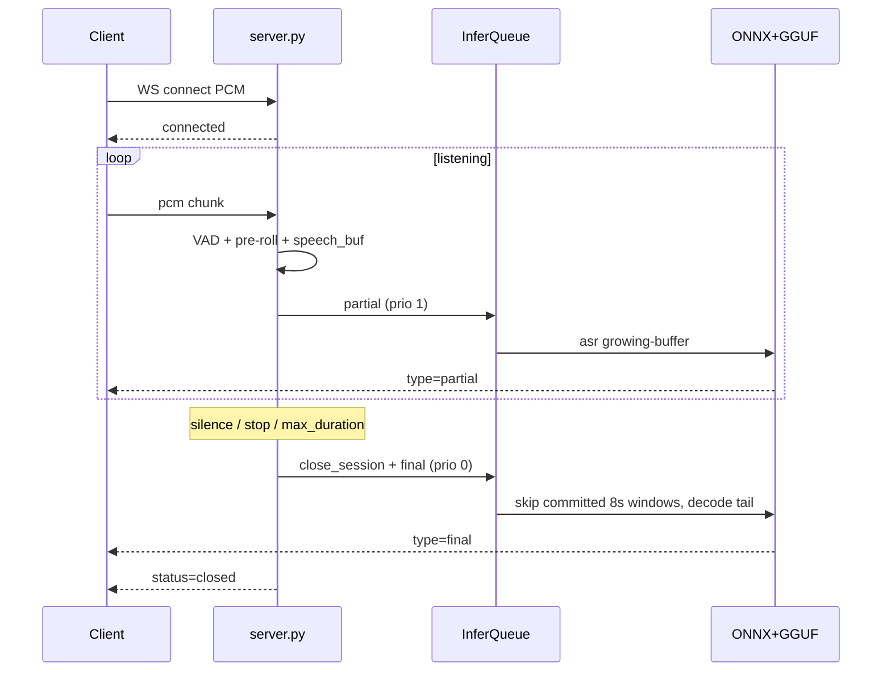

# 实时转写服务说明

Windows 本地 FastAPI 服务：一次 WebSocket 连接对应一句语音。编码器是 ONNX（DirectML），解码器是 llama.cpp GGUF（Vulkan）。没有离线 HTTP 转写，也没有 Docker / PyTorch 运行时。

环境：conda `lingting`，启动 `python run.py`（默认 `127.0.0.1:8765`）。绿色包：`packaging/build.ps1` → `dist/ASR-REALTIME/`，托盘 `ASRRealtime.exe`。

调度演进与未做项见 [STREAMING_TODO.md](./STREAMING_TODO.md)。本文描述**当前代码实际行为**。

## 1. 目录职责

| 路径 | 作用 |
|---|---|
| `run.py` | 读根目录 `.env`、单实例互斥、启动 uvicorn；Ctrl+C 吞掉 `KeyboardInterrupt` |
| `src/server.py` | FastAPI + `/realtime/stream` 会话状态机 |
| `src/inference_queue.py` | 单线程 GPU 队列：final 抢占、partial 合并、encoder 8s 边界取消 |
| `src/vad.py` | 流式 Silero VAD / 后端点 EOS |
| `src/ws_overlap.py` | onset 前 pre-roll |
| `src/backend/gguf_backend.py` | 加载引擎、按 session 挂 encoder cache |
| `vendor/qwen_asr_gguf/` | 8s 分窗 ASR、P3-A / P3-A+ cache |
| `src/itn.py` / `src/hotword_correct.py` | 仅 final 后处理 |
| `src/logger.py` / `src/paths.py` | `LOG_DIR` 解析；按天滚动文件 |
| `web/index.html` | 麦克风页：推 PCM，停止发 `{"action":"stop"}` |
| `E2Etest/` | 协议/队列单测 + Excel 批量评测 |
| `packaging/` | 绿色包：`ASRRealtime.spec` + `build.ps1` |

## 2. 启动与生命周期

1. `run.py` 切到仓库根（绿色包则切到包根），加载 `.env`，抢 `SERVER_MUTEX`。
2. uvicorn 加载 `server:app`。`lifespan` 里启动推理队列、尝试加载模型、开空闲卸载 watchdog。
3. `UNLOAD_GRACE_S=0` 时模型常驻，不因空闲卸载。
4. `/admin/warmup` 显式加载；`/admin/shutdown` 置 `should_exit`。
5. 进程退出时 `lifespan` 强制 `unload`、停队列。

## 3. HTTP / WebSocket

| 接口 | 说明 |
|---|---|
| `GET /` | 麦克风页 |
| `GET /health` | 模型状态、EOS / 最大时长配置 |
| `POST /admin/warmup` | 加载模型 |
| `POST /admin/shutdown` | 停进程 |
| `WS /realtime/stream` | 实时转写 |

并发：**同一时刻只允许一路 WebSocket**。第二路握手后收到 `WS_BUSY`（409）并断开。GPU 也只有一条 `ThreadPoolExecutor(max_workers=1)`，即使放开连接闸门，推理仍串行。

## 4. 一句话会话

```text
connected → listening → closing → idle → {status:closed} → 断开
```

- 输入：16-bit LE PCM，单声道，8 kHz 或 16 kHz（内部升到 16 kHz）。8 kHz 会过电话频带滤波。
- 一连接一句。partial **替换**全文，客户端不要拼接。
- 三种等价结束：静音 EOS、客户端 `stop`、累计 16 kHz PCM ≥ `WS_MAX_AUDIO_SECONDS`（上限 60）。都是 final → `closed` → 断开。
- 控制 JSON：`config`（语言 / VAD）、`reset`（清缓冲、保持连接）、`stop`。

### 握手（服务端 → 客户端）

```json
{
  "status": "connected",
  "session_id": "...",
  "sample_rate": 16000,
  "format": "pcm_s16le",
  "partial_seconds": 0.8,
  "max_audio_seconds": 60.0,
  "eos_silence_ms": 600,
  "early_silence_ms": 1000,
  "vad_pre_roll_ms": 400,
  "use_server_vad": true
}
```

`session_id` 来自 query `request_id`，缺省则生成 UUID。评测用 `request_id=eval-{序号}` 以便和日志对齐。

### 识别结果

| 消息 | 字段 |
|---|---|
| partial | `text`, `type=partial` |
| final | `text`, `type=final`, `start`, `end`, `eos_reason`（**无 `chars`**） |
| 结束 | `status=closed`, `reason` |

`eos_reason` / `closed.reason`：`silence` | `stop` | `max_duration` | `disconnect`。

### Query

- `sample_rate`：8000 或 16000
- `use_server_vad`：覆盖 `ASR_USE_SERVER_VAD`
- `request_id`：会话 id / 日志关联键

## 5. listening 主循环

1. 未开口的静音不进识别缓冲；环形 **pre-roll**（默认 400ms）在 onset 时拼到句首。
2. VAD 判定说话后，PCM 累加进 `speech_buf`（growing buffer）。
3. 缓冲每增加约 `WS_PARTIAL_SECONDS`（代码默认 1.5s，当前 `.env` 常为 0.8s），且未进入投机静音区间，enqueue **partial**。
4. 已 committed（约 0.8s 语音）后，静音 ≥ `WS_SPECULATIVE_FINAL_MS`（300ms）时跑 **speculative final**（不进入 CLOSING）。再开口则 cancel。真正 EOS 仍是 `WS_EOS_SILENCE_MS`（600ms）。短句未 committed 时要用更长静音：`WS_EARLY_SILENCE_MS`（1000ms）。
5. EOS / stop / 满时长 → `_finish_session`：
   - `session_phase = closing`，不再收 PCM、不再 spawn partial
   - `infer_queue.close_session`
   - `_emit_final`（若投机任务已在跑则等待复用，否则提交 `kind=final`）
   - 释放 `_active_ws`（须在嵌套函数里 `global _active_ws`）
   - 发送 `closed` 并 `websocket.close()`

`reset`：清空 `speech_buf` / pre-roll / VAD / encoder cache，保持连接。

## 6. 推理队列

`PriorityInferQueue`：priority 0 = final / speculative，1 = partial。同一 `coalesce_key`（session_id）：

- 新 partial 丢掉队列里未跑的旧 partial
- final 可取消 inflight partial（encoder 在 8s 窗边界看 `cancel_event`）
- `close_session` 把 key 加入 `_closed_keys`，之后的 partial 直接 `after_final`
- **新连接** `open_session` 会清掉该 key，避免同一 `eval-1` 复用时 partial 全被误杀

跨 session 互不抢占；但只有一个 GPU worker，多路同时说会排队。不要把「多路连上」理解成「多路同时识别还不掉尾包」。

## 7. 模型（8s 窗 + cache）

`asr()` 把整段按 `REALTIME_CHUNK_SIZE_SEC=8` 切开。不满 8s 的尾窗 pad 到 8s，**不缓存**。只缓存完整 **configured** 8s 窗，短句缩窗不算。

- **P3-A**：完整窗的 encoder embedding 按 session 缓存。
- **P3-A+**：非 last 窗且音频超过窗尾 + `WS_CHUNK_COMMIT_MARGIN_MS`（400ms）后冻结该窗文本；后续 decode **跳过**已冻结窗，尾巴仍拼接上一窗 embd + prefix。因此恰好 8.00s 的 last-flush 不会冻成截断句。
- **不做** decoder KV 复用；每次 decode 清 KV。不要改默认 8s chunk。

final 文本顺序：ASR → 中文 ITN → 热词。partial 不做这两步。

靠近冻结线的句子（例如 8.25s &lt; 8.4s、17.12s 第二窗未冻上）会多解一两个窗，final 略慢，属于边距设计，不是回归。

## 8. 日志

`LOG_DIR`（默认 `./logs`，相对仓库根或绿色包根）：

- `server_YYYY-MM-DD.log`：服务日志，零点滚动，保留 14 天
- `latest.log`：`qwen_asr_gguf` 引擎侧，按天滚动
- `service_YYYY-MM-DD.log`：托盘把子进程 stdout 接到这里

不要再往 `vendor/logs` 写。评测 `E2Etest/eval_ws_excel.py` 默认读当天 `server_YYYY-MM-DD.log`，没有则回退旧 `server.log`。

## 9. 关键环境变量

| 变量 | 默认 | 含义 |
|---|---|---|
| `WS_MAX_AUDIO_SECONDS` | 60 | 句长上限后 final+断开（必须 ≤ 60） |
| `WS_EOS_SILENCE_MS` | 600 | 后端点静音 |
| `WS_EARLY_SILENCE_MS` | 1000 | 短句更长静音 |
| `WS_PARTIAL_SECONDS` | 1.5 | partial 间隔 |
| `WS_SPECULATIVE_FINAL_MS` | 300 | 投机 final；0=关 |
| `WS_CHUNK_COMMIT_MARGIN_MS` | 400 | A+ 冻结边距 |
| `WS_VAD_PRE_ROLL_MS` | 400 | onset pre-roll |
| `ASR_USE_SERVER_VAD` | true | 可被连接 query / config 覆盖 |
| `UNLOAD_GRACE_S` | 0 | 0=常驻不卸 |
| `REALTIME_CHUNK_SIZE_SEC` | 8 | 编码器窗；不要改默认 |
| `LOG_DIR` | `./logs` | 所有日志目录 |
| `REQUEST_TIMEOUT` | 300 | 单次推理超时秒 |

## 10. 主路径



## 11. 测试与打包

```bash
conda activate lingting
python E2Etest/test_ws_tune.py
# 服务已启动时：
python E2Etest/eval_ws_excel.py
python E2Etest/eval_ws_excel.py --from 1 --to 3
```

评测脚本单实例锁，一条 wav 断干净再下一条。不要同时开网页麦克风页，否则会 `WS_BUSY`。

绿色包：`packaging/build.ps1` → `dist/ASR-REALTIME/`（含 `ASRRealtime.exe`、`runtime/`、`app/`、空的 `models/` `logs/`）。模型需另行拷入 `models/`。细节见 `packaging/README.md`。
